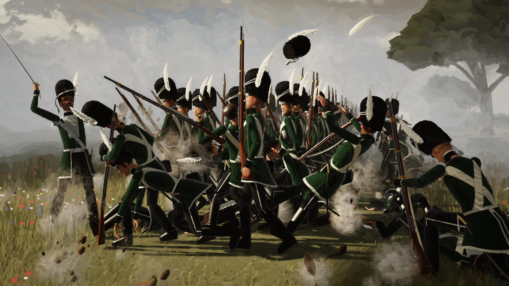

# The Ripelzen Guard Advancing Under Fire

A procedural, code-only historical battle painting. The elite Ripelzen Guard infantry of the World
of Austeria advance through the Morelian countryside while unseen artillery tears canister through
their ranks.



No image generator, no stock art and no 3D assets are used. Every guardsman, uniform, bearskin,
musket, blade of grass, tree, cloud and brush stroke is built and rendered by the JavaScript in
this folder. The renderer has **zero dependencies** and needs only Node.js 18+.

## Rendering it

```bash
cd ripelzen-guard-battle
node render.mjs                      # 3840x2160, 2x2 supersampled (about 4-5 min, single thread)
node render.mjs --w 1920 --h 1080    # about 1 min
node render.mjs --w 1280 --h 720 --ss 1 --fast   # quick composition preview (about 30 s)
```

The output is written to `output/ripelzen-guard-battle.png` (or `--out <file>`).

The render is deterministic: every random choice comes from seeded generators, so the same code
always paints the same picture.

Helper tools:

- `tools/figure-sheet.mjs` renders single guardsmen on a neutral ground for checking the model: standing like the reference portrait (`stand`), marching with each musket carry (`march`), or face close-ups (`face`, `face34`)
- `tools/crop.mjs` crops or enlarges a region of a rendered PNG
- `tools/preview.mjs` makes the downscaled preview

## How it works

| Stage | Code | What it does |
| --- | --- | --- |
| Rasteriser | `src/core/raster.mjs` | Z-buffered triangle rasteriser with perspective-correct attributes, per-fragment materials, near-plane clipping, and PCF soft shadow maps |
| Lighting | `src/core/light.mjs` | Warm raking sun broken into patches by the smoke, cool sky fill, ground bounce, specular, Kajiya-Kay fur highlights, normal perturbation for cloth folds, and aerial perspective |
| Guardsman | `src/figure/*` | Skeleton with forward kinematics for the trunk and two-bone IK for limbs, plus parametric surfaces for body, face, hands and uniform |
| Poses | `src/figure/poses.mjs`, `actions.mjs` | Gait cycle, four musket carries with real hand grips, and the dramatic pose library (thrown back, collapsing sideways, dropping to a knee, bearskin knocked loose, falling forward, clutching a wound, recoiling, sagging, lying, rising on a musket, crouching beside a comrade, officers rallying and dressing the line) |
| Story | `src/scene/story.mjs` | Who stands where, who is struck and how, who reaches for whom |
| Formation | `src/scene/formation.mjs` | Three ranks and hundreds of files, each man with his own height, build, face, age, gait phase, lean, carry, head turn and expression |
| Countryside | `src/world/*` | Heightfield hills, field patchwork, farm lane, grass blades and wildflowers, oaks and poplars, hedgerows, dry-stone wall, broken fence, an overturned basket and pitchfork, a cart, haystacks, fleeing cattle, and a village with church and orchards |
| Sky | `src/world/sky.mjs` | Towering cumulus rising out of the gun smoke, a smoke-stained ceiling, a muted blue break with sunbeams |
| Effects | `src/fx/*`, `src/scene/effects.mjs` | Analytic volumetric smoke integrated per ray and clipped by scene depth (so it threads between the soldiers), dust spurts, flying earth and turf, shell bursts, a ricochet trail and muzzle flashes glimpsed through smoke |
| Painting | `src/post.mjs`, `src/paint.mjs` | Warm neoclassical grading, a structure-tensor flow field, Hertzmann-style layered brush strokes (coarse to fine, edge-stopping, broken colour, bristle texture), canvas weave and vignette |

### The uniform

The uniform follows the reference portrait:

- deep dark-green coat with a black standing collar and black cuffs, all edged in pale piping
- silver-grey plastron with pewter buttons
- white buff crossbelts meeting at a brass oval plate
- white waist belt with a brass buckle plate
- black trousers with a pale outer stripe, and tall polished black boots
- sabre on the left hip with a white sword knot, and cartridge box on the right hip
- black fur bearskin with a silver front plate and stag insignia, silver cords and tassels, and a tall white plume on the left

Officers are set apart only by period details: a silver gorget, silver epaulettes, longer skirts,
a drawn sword and no crossbelts.

### Staging

The viewer stands at shoulder height, just behind the flank of the rear rank, looking diagonally
along the line as it advances left toward an enemy hidden beyond the smoke. Canister has just
struck the flank files:

- one man is thrown backward as his musket slips away
- another collapses sideways into the neighbour who catches him
- a man drops onto one knee
- a man twists as his bearskin flies off
- a man pitches face-forward while his musket spins through the air
- a man clutches his side and stays on his feet

Turf and dust erupt, a plume is torn free and a cartridge box is flying loose. Along the rest of
the line, musket balls claim individual men, and survivors close the gaps, duck, glance at the
fallen and reach for them. The captain turns back to rally the files with his sword raised toward
the guns, and a lieutenant and sergeant dress the line. Behind the line, a guardsman crouches over
a fallen comrade, a wounded man pushes himself up on his musket, and stretcher bearers carry a man
to the rear through the smoke.
